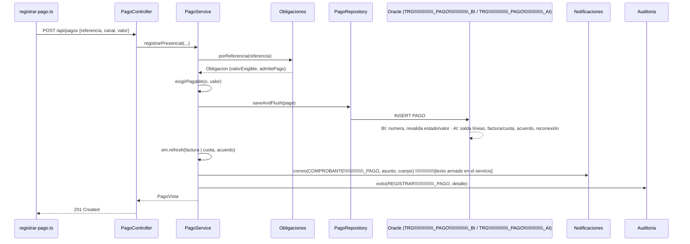
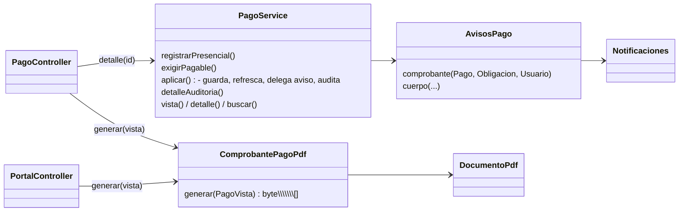

# Diagnóstico técnico y refactorización · Registro de pagos (SIGCA-EPQ)

Ingeniería de Software II · Taller de refactorización y cierre de arquitectura

> Las rutas son relativas a la raíz del repositorio. Los números de línea corresponden a la \\\\\\\\\\\\\\\*\\\\\\\\\\\\\\\*línea base\\\\\\\\\\\\\\\*\\\\\\\\\\\\\\\*
> (commit `chore: estado inicial del proyecto`), salvo que se indique "después".
> Abreviatura usada en todo el documento: `…/sigca/` = `backend/src/main/java/co/gov/epq/sigca/`.

\---

## 1\. Contexto

|Campo|Valor|
|-|-|
|Equipo|*\[Integrantes del equipo]*|
|Repositorio|*\[URL del repositorio en GitHub]*|
|Proyecto|SIGCA-EPQ: gestión comercial y atención al cliente de Empresas Públicas del Quindío|
|Tecnología|Spring Boot 4.1 · Java 21 · Hibernate 7 · Oracle 23 (reglas en triggers y `PKG\\\\\\\\\\\\\\\_SIGCA`) · Angular 21|
|Arquitectura|Monolito modular por paquetes de dominio (`pagos/`, `facturacion/`, `cartera/`…), capas controlador → servicio → repositorio JPA, con reglas de integridad replicadas en Oracle ("validaciones en las tres capas", `README.md`)|
|Funcionalidad|**Registro de un pago** de una factura o de una cuota de acuerdo (caja, recaudo bancario y confirmación de la pasarela en línea) y emisión del comprobante|
|Requisitos|RF-06 (registrar pagos), CU-04 (pagar), P-05 / CO-02 (sin abonos: se paga el valor exigible exacto), P-23 (recaudo bancario con referencia), RN-05 y RN-15 (pago en línea solo con aprobación firmada e idempotente), RN-33 (lo que está en reclamo no es exigible), RN-36 (reconexión automática al pagar), SWR-08 (comprobante electrónico). Las referencias salen de los Javadoc de `PagoService`, `PagoController` y `PagoEnLineaService` y de `docs/guia-pruebas.md` (E6, E7, E9.7)|

**Por qué esta funcionalidad.** Es una transacción de negocio que en un solo `INSERT` en `PAGO` cambia el
estado de varias entidades: `LINEA\\\\\\\\\\\\\\\_FACTURA`, `FACTURA`, `CUOTA\\\\\\\\\\\\\\\_ACUERDO`, `ACUERDO\\\\\\\\\\\\\\\_PAGO`, `COBRO\\\\\\\\\\\\\\\_PERSUASIVO` y
`ORDEN\\\\\\\\\\\\\\\_SERVICIO` (reconexión), y además deja `NOTIFICACION` y `LOG\\\\\\\\\\\\\\\_AUDITORIA`. La usan tres canales (caja, banco y
pasarela) y dos clientes (funcionario y portal ciudadano).

## 2\. Arquitectura real

### 2.1 Componentes

|Capa|Componente|Responsabilidad observada|
|-|-|-|
|Frontend|`frontend/src/app/features/pagos/registrar-pago.ts`, `pagos.service.ts`|Busca la obligación, envía el pago y descarga el comprobante|
|Controlador|`…/sigca/pagos/PagoController.java`|`GET /api/pagos/obligacion`, `POST /api/pagos`, consulta y `GET /api/pagos/{id}/comprobante`; DTO `PagoRequest` con Bean Validation|
|Controlador|`…/sigca/portal/PortalController.java`|`GET /api/portal/pagos/{id}/comprobante` del ciudadano|
|Servicio|`…/sigca/pagos/PagoService.java`|Registro presencial, aplicación del pago (también la usa el pago en línea), vista, búsqueda y PDF del comprobante|
|Servicio|`…/sigca/pagos/PagoEnLineaService.java`|Intento ante la pasarela y webhook; delega en `PagoService.aplicar`|
|Dominio / consulta|`…/sigca/pagos/Obligaciones.java`, `Obligacion.java`|Resuelve la referencia (FAC-… o AP-…-NN), calcula el valor exigible y si admite pago|
|Persistencia|`PagoRepository`, `PagosCuotasRepository`, `PagosAcuerdosRepository`, `facturacion/FacturaRepository`, `facturacion/FacturacionUsuariosRepository`|JPA|
|Transversales|`auditoria/Auditoria`, `notificaciones/Notificaciones` (cola), `facturacion/DocumentoPdf` (utilidades OpenPDF)||
|Base de datos|`database/sql/03\\\\\\\\\\\\\\\_logica.sql`: `TRG\\\\\\\\\\\\\\\_PAGO\\\\\\\\\\\\\\\_BI` (l. 1685), `TRG\\\\\\\\\\\\\\\_PAGO\\\\\\\\\\\\\\\_AI` (l. 1752), `TRG\\\\\\\\\\\\\\\_PAGO\\\\\\\\\\\\\\\_BUD` (l. 1800)|Numera el pago, revalida estado y valor, salda líneas/cuota/acuerdo, reconecta y cierra el cobro persuasivo|

### 2.2 Dependencias de `PagoService` (línea base, l. 42-50)

`PagoRepository`, `Obligaciones`, `FacturaRepository`, `PagosCuotasRepository`, `PagosAcuerdosRepository`,
`FacturacionUsuariosRepository`, `Auditoria`, `Notificaciones`, `EntityManager`, y de forma estática
`DocumentoPdf` (PDF) y `UsuarioActual` (seguridad).

### 2.3 Flujo del pago presencial



El pago en línea entra por `ReceptorWebhook` → `PagoEnLineaService.procesar` y desde la aprobación sigue el mismo
camino (`PagoService.aplicar`, `PagoEnLineaService.java` l. 142). El comprobante sale de
`PagoController.comprobante` o `PortalController.comprobante` → `PagoService.comprobante` → `DocumentoPdf`.

### 2.4 Pruebas que protegen la funcionalidad (línea base)

|Prueba|Tipo|Qué cubre|Requisito para correrla|
|-|-|-|-|
|`backend/src/test/.../pagos/PagoPresencialIT.java`|Integración (MockMvc + Oracle)|Valor exigible, rechazo de abonos, estado PAGADA, auditoría (1 registro), notificación (1 registro), PDF, doble pago (409), recaudo bancario|Oracle local con esquema y semilla (`mvn verify`)|
|`backend/src/test/.../pagos/PagoEnLineaIT.java`|Integración|Webhook firmado, idempotencia, firma inválida, rechazo, obligaciones ajenas|Igual|
|`frontend/.../pagos/pagos.service.spec.ts`|Unitaria (vitest)|Patrón de referencia y URL de checkout|Node|

No existía ninguna prueba unitaria de `PagoService`: todo su comportamiento dependía de una base Oracle levantada.

\---

## 3\. Hallazgos

Se verificaron manualmente los cinco hallazgos (ubicación, fragmento y consecuencia) sobre el código; las
sugerencias de la IA que no se pudieron comprobar se descartaron. H-01 y H-03 son de arquitectura / SOLID.

### H-01 · `PagoService` mezcla la transacción del pago con la redacción del correo y el PDF del comprobante

|Campo|Contenido|
|-|-|
|Tipo|**Riesgo arquitectónico** (SRP, cohesión; inconsistencia con el patrón del propio proyecto)|
|Ubicación|`…/sigca/pagos/PagoService.java`: `aplicar` l. 98-145 (correo l. 121-130, detalle de auditoría l. 132-143) y `comprobante` l. 198-213|
|Evidencia|`notificaciones.correo(EventoNotificacion.COMPROBANTE\\\\\\\\\\\\\\\_PAGO, u.getCorreo(), u.getId(), "Comprobante de pago " + p.getCodigoPago(), "Hola " + u.getNombreCompleto() + ",\\\\\\\\\\\\\\\\n\\\\\\\\\\\\\\\\nRecibimos su pago.\\\\\\\\\\\\\\\\n" + ...` (l. 121-130) y `return DocumentoPdf.generar("Comprobante de pago " + v.codigoPago(), doc -> doc.add(DocumentoPdf.datos("Comprobante", ...` (l. 202-212)|
|Observación|La misma clase decide **qué** se registra (pago, refresco de la obligación, auditoría) y **cómo se presenta** (texto del correo, maquetación del PDF). Son motivos de cambio distintos: una nueva redacción del correo o un cambio de formato del comprobante obliga a abrir y volver a probar la clase que sostiene la transacción del dinero. No es una sospecha por longitud: el método `aplicar` ocupa unas 48 líneas, y el problema es que contiene texto de presentación|
|Criterio|SRP (un motivo de cambio por clase); cohesión; consistencia arquitectónica: el proyecto ya separa estas responsabilidades en otros módulos: `facturacion/FacturaPdf.java` (PDF de la factura como `@Component`, usado por `FacturaController` y `PortalController`) y `pqr/AvisosPqr.java` ("Textos y destinatarios de las notificaciones de PQR")|
|Impacto y riesgo|Impacto medio: `aplicar` es el punto común de caja, banco y pasarela (`PagoEnLineaService` l. 142), así que un error al tocar el texto afecta los tres canales. El PDF se genera desde dos controladores (`PagoController` l. 86 y `PortalController` l. 120). Sin pruebas unitarias del servicio, cualquier cambio de texto exige Oracle para probarse|
|Acción propuesta|Extraer `AvisosPago` (texto y envío del correo del comprobante) y `ComprobantePagoPdf` (maquetación del PDF), siguiendo `AvisosPqr` y `FacturaPdf`; extraer el armado del detalle de auditoría a un método con nombre. Los controladores usan `ComprobantePagoPdf` como ya usan `FacturaPdf`|
|Verificación|Pruebas de caracterización escritas **antes** del cambio (correo exacto, detalle de auditoría, orden de operaciones, contenido del PDF) que deben pasar sin modificar sus aserciones después; `PagoPresencialIT` y `PagoEnLineaIT`|
|Estado|**Seleccionado**|

### H-02 · `COMPROBANTE\\\\\\\\\\\\\\\_ENVIADO` se marca cuando el correo solo se encola

|Campo|Contenido|
|-|-|
|Tipo|**Defecto funcional** (menor: información incorrecta al usuario; no afecta dinero)|
|Ubicación|`…/sigca/pagos/PagoService.java` `aplicar` l. 102 y 116; `…/sigca/notificaciones/Notificaciones.java` `correo` (encola) y `despachar` (envía después, puede terminar en `FALLIDA`); `frontend/src/app/features/pagos/registrar-pago.ts` l. 79|
|Evidencia|`boolean conCorreo = u.getCorreo() != null \\\\\\\\\\\\\\\&\\\\\\\\\\\\\\\& !u.getCorreo().isBlank();` … `p.setComprobanteEnviado(conCorreo);` y en la pantalla del cajero `@if (c.comprobanteEnviado) { El comprobante se envió al correo del titular. }`|
|Observación|El indicador se calcula con "el titular tiene correo", no con "el correo salió". `Notificaciones.correo` solo inserta en `NOTIFICACION`; el envío real lo hace `despachar()` cada 30 s y, tras `NOTIFICACION\\\\\\\\\\\\\\\_MAX\\\\\\\\\\\\\\\_INTENTOS`, deja la notificación en `FALLIDA`. Ningún código vuelve a actualizar `PAGO.COMPROBANTE\\\\\\\\\\\\\\\_ENVIADO` (búsqueda de `setComprobanteEnviado`: un solo uso)|
|Criterio|Corrección funcional / exactitud de la información (SWR-08)|
|Impacto y riesgo|El cajero informa al ciudadano que el comprobante le llegó cuando puede no haber salido nunca. Impacto bajo-medio; corregirlo toca `notificaciones`, `pagos`, el frontend y probablemente el texto de la pantalla|
|Acción propuesta|Corrección de defecto (no refactorización): renombrar el mensaje a "se enviará" o actualizar `COMPROBANTE\\\\\\\\\\\\\\\_ENVIADO` cuando `despachar` marque `ENVIADA` la notificación con `ENTIDAD='PAGO'`. Requiere decidir con el cliente cuál es el significado del campo|
|Verificación|Prueba de integración: pago con correo y `EnviadorCorreo` que falla → la vista no debe afirmar envío|
|Estado|Pendiente (requiere aclarar el requisito)|

### H-03 · El módulo `pagos` depende de piezas internas de `facturacion`, y un controlador depende de otro

|Campo|Contenido|
|-|-|
|Tipo|**Riesgo arquitectónico** (acoplamiento entre módulos; DIP)|
|Ubicación|`…/sigca/pagos/PagoService.java` l. 21 y 25; `…/sigca/pagos/Obligaciones.java` l. 20; `…/sigca/pagos/PasarelaSimuladaController.java` l. 26; `…/sigca/portal/PortalController.java` l. 120; `…/sigca/pagos/PagoController.java` l. 89|
|Evidencia|`import co.gov.epq.sigca.facturacion.FacturacionUsuariosRepository;` (repositorio de `Usuario` declarado para facturación) e `import co.gov.epq.sigca.facturacion.DocumentoPdf;` (utilidad genérica de PDF); `return PagoController.pdf(codigo, pagos.comprobante(id));`|
|Observación|El proyecto sigue la convención de repositorios por módulo (`PagosCuotasRepository`, `PagosAcuerdosRepository`, `FacturacionContratosRepository`…), pero `pagos` reutiliza el repositorio de usuarios **de facturación** en lugar de uno propio o de `usuarios/UsuarioRepository`. `DocumentoPdf` es transversal (lo usan facturas y comprobantes) pero vive en `facturacion/`, aunque el `README` reserva `common/` para lo compartido. Además `PortalController` invoca un método estático de `PagoController` para armar la respuesta HTTP|
|Criterio|Bajo acoplamiento entre módulos, dependencias hacia abstracciones o paquetes comunes, estructura documentada en `README.md` ("common/ errores, cifrado, validaciones, periodos")|
|Impacto y riesgo|Un cambio en `FacturacionUsuariosRepository` (por ejemplo, una consulta con proyección para facturación) puede romper pagos; `facturacion` se vuelve un "módulo cubo" del que dependen otros. Impacto medio, riesgo bajo de error inmediato|
|Acción propuesta|Mover `DocumentoPdf` y el armado de la respuesta PDF a `common/pdf`; crear `PagosUsuariosRepository` o usar `UsuarioRepository`|
|Verificación|Compilación + `PagoPresencialIT`, `FacturaIT`, pruebas del portal|
|Estado|Pendiente (toca 3 módulos; se deja como deuda)|

### H-04 · La regla "la obligación admite pago" está duplicada y vive como método estático del servicio

|Campo|Contenido|
|-|-|
|Tipo|**Deuda técnica** (duplicación; código muerto)|
|Ubicación|`…/sigca/pagos/PagoService.java` `exigirPagable` l. 84-92; `…/sigca/pagos/PagoEnLineaService.java` `iniciar` l. 65-67; `…/sigca/pagos/Obligaciones.java` l. 32; `…/sigca/pagos/PagoController.java` l. 99|
|Evidencia|En ambos servicios: `if (!o.admitePago()) { throw new ConflictoException("NO\\\\\\\\\\\\\\\_ADMITE\\\\\\\\\\\\\\\_PAGOS", o.motivoNoAdmite()); }`. `Obligaciones.PATRON\\\\\\\\\\\\\\\_REFERENCIA` es `public static final` y no se usa en ningún archivo del backend (búsqueda en `backend/src`); el mismo patrón se repite como literal en `PagoRequest`|
|Observación|Una invariante del objeto `Obligacion` se expresa fuera de él, en dos lugares, y una de las copias es `public static` en un `@Service`. Si cambia el código de error o la condición, hay que recordar ambos sitios. La constante sin uso sugiere que se quiso centralizar el patrón y no se terminó|
|Criterio|DRY; ubicación de reglas de negocio en el dominio ("¿dónde se aplican las invariantes?")|
|Impacto y riesgo|Bajo: hoy ambas copias son idénticas|
|Acción propuesta|`Obligacion.exigirAdmitePago()` y `Obligacion.exigirValor(BigDecimal)`; usar `Obligaciones.PATRON\\\\\\\\\\\\\\\_REFERENCIA` en `PagoRequest` (con `flags = CASE\\\\\\\\\\\\\\\_INSENSITIVE`) o eliminar la constante|
|Verificación|`PagoPresencialIT` (409 en doble pago, 422 en abono) y `PagoEnLineaIT`|
|Estado|Pendiente (prioridad 2)|

### H-05 · Las reglas de admisión del pago están en Java y en el trigger `TRG\\\\\\\\\\\\\\\_PAGO\\\\\\\\\\\\\\\_BI`

|Campo|Contenido|
|-|-|
|Tipo|**Oportunidad de mejora** (decisión de arquitectura documentada; **no se modifica el código**)|
|Ubicación|`…/sigca/pagos/Obligaciones.java` `deFactura` l. 86-105 y `deCuota` l. 107-126; `database/sql/03\\\\\\\\\\\\\\\_logica.sql` `TRG\\\\\\\\\\\\\\\_PAGO\\\\\\\\\\\\\\\_BI` l. 1700-1736|
|Evidencia|Java: `BigDecimal exigible = f.getSaldoPendiente().subtract(f.getValorEnReclamo());` y `switch (f.getEstado()) { case PAGADA -> … case EN\\\\\\\\\\\\\\\_ACUERDO -> …`. Oracle: `v\\\\\\\\\\\\\\\_total := v\\\\\\\\\\\\\\\_factura.SALDO\\\\\\\\\\\\\\\_PENDIENTE - v\\\\\\\\\\\\\\\_factura.VALOR\\\\\\\\\\\\\\\_EN\\\\\\\\\\\\\\\_RECLAMO;` y `IF v\\\\\\\\\\\\\\\_factura.ESTADO = 'EN\\\\\\\\\\\\\\\_ACUERDO' THEN …`|
|Observación|La duplicación es intencional y está declarada en `README.md` ("Validaciones en las tres capas"): Java da mensajes útiles al cajero y la base garantiza la integridad aunque el pago llegue por otro camino. El riesgo es que las dos versiones diverjan sin que nadie lo note|
|Criterio|Consistencia entre capas; trazabilidad de decisiones de arquitectura|
|Impacto y riesgo|Bajo mientras existan pruebas de integración que ejerzan ambos lados (`PagoPresencialIT` ya prueba abono y doble pago)|
|Acción propuesta|Ninguna en el código. Documentar la decisión como ADR y añadir casos de integración para cuotas fuera de orden y factura `EN\\\\\\\\\\\\\\\_ACUERDO`|
|Verificación|No aplica|
|Estado|Aceptado como decisión de diseño|

\---

## 4\. Priorización

Escala 1 (bajo) a 3 (alto). **Riesgo** = riesgo de romper algo al intervenir (más alto, peor).
Puntaje = impacto × 2 − riesgo − esfuerzo + 3 (más alto, mejor candidato).

|ID|Impacto|Riesgo de intervenir|Esfuerzo|Puntaje|Decisión|
|-|-|-|-|-|-|
|H-01|3|1|2|6|**Intervenir ahora**|
|H-04|2|1|1|5|Siguiente iteración|
|H-02|2|2|2|3|Requiere aclarar el requisito; es corrección de defecto, no refactorización|
|H-03|2|2|3|2|Deuda registrada; toca 3 módulos|
|H-05|1|3|2|0|No se interviene (decisión documentada)|

**Razón de la selección de H-01.** Es un hallazgo de arquitectura (SRP y consistencia con `FacturaPdf` /
`AvisosPqr`), está en el punto por el que pasan los tres canales de pago, y se puede hacer sin cambiar el
comportamiento observable: el texto del correo, el detalle de auditoría, el orden de las operaciones dentro de la
transacción y el contenido del PDF se pueden fijar con pruebas de caracterización **antes** de mover código. No
toca el esquema Oracle ni los contratos HTTP. H-04 tiene mejor relación esfuerzo/beneficio pero menor impacto;
H-02 no es una refactorización y alteraría el comportamiento.

\---

## 5\. Intervención

**Cambio elegido:** H-01. Tipo: **refactorización** (no corrige defectos; H-02 queda sin tocar a propósito).

### 5.1 Diseño antes y después

```mermaid
classDiagram
    direction LR
    class PagoService\\\\\\\\\\\\\\\_antes\\\\\\\\\\\\\\\["PagoService (antes)"] {
        registrarPresencial()
        exigirPagable()
        aplicar() - guarda, refresca, redacta correo, arma auditoría
        vista() / detalle() / buscar()
        comprobante() - maqueta el PDF
    }
    PagoService\\\\\\\\\\\\\\\_antes --> Notificaciones
    PagoService\\\\\\\\\\\\\\\_antes --> DocumentoPdf
    PagoController --> PagoService\\\\\\\\\\\\\\\_antes : comprobante(id)
    PortalController --> PagoService\\\\\\\\\\\\\\\_antes : comprobante(id)
```



|Aspecto|Antes|Después|
|-|-|-|
|Responsabilidades de `PagoService`|transacción + texto del correo + PDF|transacción (guardar, refrescar, auditar) y consultas|
|Líneas de `PagoService.java` / de `aplicar`|219 / 48|195 / 25|
|Dependencia de `PagoService` con `notificaciones`|directa (`Notificaciones`, `EventoNotificacion`)|a través de `AvisosPago` (mismo paquete)|
|Dónde se cambia el texto del correo|`PagoService.aplicar`|`AvisosPago.cuerpo`|
|Dónde se cambia el comprobante PDF|`PagoService.comprobante`|`ComprobantePagoPdf.generar`|
|Patrón|distinto de facturación y PQR|igual que `FacturaPdf` / `AvisosPqr`|
|Consultas para descargar el comprobante en `/api/pagos/{id}/comprobante`|2 lecturas del pago (`obtener` + `comprobante`)|1 (`detalle`)|

Decisiones:

* `AvisosPago` toma canal y código de transacción del `Pago` guardado en lugar de recibir los parámetros sueltos de
`aplicar`: son los mismos valores (`aplicar` los asigna con `setCanalPago` y `setCodigoTransaccion` antes de
guardar), y así el método no necesita siete argumentos.
* La auditoría se queda en `PagoService` porque es parte de la transacción del pago, no de la presentación; solo se
extrajo el armado del mapa a `detalleAuditoria`, que conserva el orden de las claves.
* `ComprobantePagoPdf` recibe la `PagoVista` ya resuelta, como `FacturaPdf` recibe `FacturaDetalle`, y lo invocan los
controladores, como hacen `FacturaController` y `PortalController` con la factura. Se mantiene la verificación de
propiedad del portal (`codigoPagoPropio`) antes de generar el PDF.
* No se movieron `DocumentoPdf` ni `PagoController.pdf` (H-03) para mantener el cambio acotado.

### 5.2 Archivos afectados

|Archivo|Cambio|
|-|-|
|`…/sigca/pagos/AvisosPago.java`|**Nuevo**: correo del comprobante|
|`…/sigca/pagos/ComprobantePagoPdf.java`|**Nuevo**: PDF del comprobante|
|`…/sigca/pagos/PagoService.java`|`Notificaciones` → `AvisosPago`; `aplicar` delega; nuevo `detalleAuditoria`; se elimina `comprobante(id)`|
|`…/sigca/pagos/PagoController.java`|Inyecta `ComprobantePagoPdf`; `comprobante` usa `detalle` + `generar`|
|`…/sigca/portal/PortalController.java`|Inyecta `ComprobantePagoPdf` para el comprobante del ciudadano|
|`backend/src/test/.../pagos/PagoServiceCaracterizacionTest.java`|Solo los dos métodos de *fixture* (constructor y obtención del PDF)|

No cambian: contratos HTTP, DTO, esquema Oracle, triggers, frontend ni permisos.

## 6\. Verificación

### 6.1 Estrategia

1. **Antes de tocar el código** (commit `test: caracterizar…`) se escribieron 10 pruebas unitarias de
caracterización en `PagoServiceCaracterizacionTest` (JUnit 5 + Mockito + AssertJ, sin Oracle):

|Prueba|Qué fija|
|-|-|
|`pagoPresencialDeFacturaGuardaElPagoConLosDatosDeLaObligacion`|Los 11 campos del `Pago` que se inserta|
|`losEfectosOcurrenEnOrdenGuardarRefrescarNotificarAuditar`|Orden dentro de la transacción|
|`elCorreoDelComprobanteConservaDestinatarioAsuntoYCuerpo`|Evento, destinatario, asunto y cuerpo exactos|
|`elPagoEnLineaIncluyeLaTransaccionEnElCorreoYEnLaAuditoria`|Canal EN\_LINEA, código de transacción en correo y auditoría|
|`laAuditoriaDelPagoPresencialTieneLasClavesEnOrdenYSinOpcionales`|Operación, entidad y detalle con claves en orden|
|`elRecaudoBancarioAuditaLaReferenciaDelBanco`|P-23 en el pago y en la auditoría|
|`sinCorreoElComprobanteNoQuedaMarcadoComoEnviado…`|`COMPROBANTE\\\\\\\\\\\\\\\_ENVIADO = N` y llamada a la cola con destino en blanco|
|`elPagoDeUnaCuotaRefrescaLaCuotaYElAcuerdo`|Rama de cuota: refresca cuota y luego acuerdo, referencia `AP-…-00`|
|`elComprobantePdfConservaTituloYDatosDelPago`|PDF válido, 1 página, título y datos del pago en el contenido|
|`laVistaDelPagoNoCambia`|`PagoVista` completa|

2. **Regla de conservación:** después del cambio solo pueden variar los métodos de *fixture* de la prueba;
`git diff f4600da fb3a334 -- backend/src/test` muestra 5 líneas cambiadas, todas en `crearServicio()` y
`comprobante(Long)`.
3. **Integración existente** contra Oracle: `PagoPresencialIT` (1 auditoría, 1 notificación `COMPROBANTE\\\\\\\\\\\\\\\_PAGO`, PDF,
doble pago 409, recaudo bancario) y `PagoEnLineaIT` (webhook, idempotencia).
4. **Manual (guía E6.8 y E7):** pago presencial de `FAC-202608-0000002` y pago en línea de `FAC-202609-0000004`,
descarga del comprobante desde **Registrar pago** y desde **Mis pagos** del portal, y consulta de
`NOTIFICACION` (`EVENTO = 'COMPROBANTE\\\\\\\\\\\\\\\_PAGO'`) para comparar el cuerpo del correo antes y después.

### 6.2 Resultados

|Comprobación|Antes (`f4600da`)|Después (`fb3a334`)|Evidencia|
|-|-|-|-|
|Literales del correo, auditoría y PDF (mismos y en el mismo orden)|—|17/17, 7/7, 15/15 idénticos|`evidencias/comparacion-literales.txt`|
|Llamadas a `PagoService.comprobante` · dependencias de `PagoService` con `Notificaciones`|2 · 1|0 · 0|`evidencias/comprobaciones-estaticas.txt`|
|Errores de sintaxis (javac 21) en los 6 archivos tocados|—|0|`evidencias/comprobaciones-estaticas.txt`|
|`PagoServiceCaracterizacionTest` (10 pruebas)|*pendiente: ejecutar*|*pendiente: ejecutar*|`evidencias/pruebas-antes.txt`, `evidencias/pruebas-despues.txt`|
|`mvn test` (todas las unitarias)|*pendiente*|*pendiente*|ídem|
|`PagoPresencialIT`, `PagoEnLineaIT`, `CarteraIT`|*pendiente*|*pendiente*|ídem con `INTEGRACION=1`|

Para producir las dos evidencias (desde la raíz del repositorio):

```bash
git checkout <hash de "test: caracterizar…">
docs/refactorizacion/evidencias/ejecutar-verificacion.sh antes        # INTEGRACION=1 para incluir Oracle
git checkout <hash de "refactor: separar…">
docs/refactorizacion/evidencias/ejecutar-verificacion.sh despues
git checkout main
```

Resultado esperado: `Tests run: 10, Failures: 0, Errors: 0` en ambos momentos y las mismas cifras de las IT.
Si alguna prueba de caracterización falla **antes** del cambio, el error está en la prueba (no describe el
comportamiento actual) y se corrige antes de evaluar la refactorización.

### 6.3 Limitaciones

* El diagnóstico y el cambio se prepararon en un entorno sin acceso a Maven Central ni a Docker/Oracle, así que
ahí solo se pudieron hacer las comprobaciones estáticas de la tabla. Las filas marcadas *pendiente* deben
completarse con la salida del script en la máquina del equipo.
* Las pruebas unitarias sustituyen los triggers con dobles: no prueban que Oracle salde la factura ni que
reconecte; eso lo siguen cubriendo las IT.
* El PDF se compara por título, número de páginas y presencia de los datos en el flujo de contenido, no byte a byte
(OpenPDF incluye fecha de creación e identificadores distintos en cada generación).
* La prueba de PDF usa `PdfReader` de OpenPDF 3 (`org.openpdf.text.pdf`); si la versión del proyecto cambia de
paquete, ajustar ese import.

## 7\. Cierre

**Lecciones.**

* La IA propuso hallazgos útiles, pero algunos no se sostenían al revisarlos (por ejemplo, "método largo = viola
SRP"); el argumento válido para H-01 fue el **motivo de cambio** (texto y formato frente a transacción) y la
comparación con patrones que el propio proyecto ya usa (`FacturaPdf`, `AvisosPqr`).
* No todo hallazgo se refactoriza: H-05 es una decisión de arquitectura documentada y H-02 es un defecto, que
cambiaría el comportamiento y debe declararse y tratarse como corrección.
* Las pruebas de caracterización antes del cambio son lo que permite afirmar que "el comportamiento se conserva";
sin ellas, la única red era una suite de integración que exige Oracle.

**Deuda técnica pendiente** (en orden de prioridad):

1. H-04: llevar la regla de admisión a `Obligacion` y usar `Obligaciones.PATRON\\\\\\\\\\\\\\\_REFERENCIA` o eliminarla.
2. H-02: aclarar el significado de `COMPROBANTE\\\\\\\\\\\\\\\_ENVIADO` y corregir el mensaje del cajero o actualizar el campo al
enviar.
3. H-03: mover `DocumentoPdf` y la respuesta PDF a `common/`, y dar a `pagos` su propio acceso a usuarios.
4. H-05: registrar la decisión "reglas en Java y en Oracle" como ADR y añadir IT de cuotas fuera de orden y factura
`EN\\\\\\\\\\\\\\\_ACUERDO`.

**Vínculo con el proceso de desarrollo (pregunta de cierre).** Estos problemas se habrían detectado antes con:

* **Revisión de código con lista de verificación de arquitectura** en cada *pull request* ("¿la clase tiene más de
un motivo de cambio?", "¿sigue el patrón existente del proyecto, como `XxxPdf` / `AvisosXxx`?", "¿importa
paquetes internos de otro módulo?"). H-01 y H-03 se ven en el diff de la primera versión de `PagoService`.
* **Pruebas unitarias en la definición de terminado** de cada historia: escribir la prueba del correo habría
obligado a construir `PagoService` con nueve dependencias, señal temprana de baja cohesión.
* **Reglas automáticas de arquitectura** (por ejemplo ArchUnit en `mvn test`): "`pagos` no depende de
`facturacion..\\\\\\\\\\\\\\\*Repository`", "ningún controlador depende de otro controlador".
* **Criterios de aceptación verificables** para SWR-08 ("el comprobante se envió" frente a "se encoló"), que habrían
expuesto H-02 durante el refinamiento.

## 8\. Git

|Commit|Mensaje|Contenido|
|-|-|-|
|`76f9a6a`|`chore: estado inicial del proyecto (linea base del taller)`|Código recibido (solo en la copia de trabajo del taller)|
|`75b5273`|`docs: registrar diagnostico tecnico`|Secciones 1-4 de este informe|
|`f4600da`|`test: caracterizar el registro de pagos antes de refactorizar`|`PagoServiceCaracterizacionTest`, script de evidencias|
|`fb3a334`|`refactor: separar responsabilidades del registro de pagos`|`AvisosPago`, `ComprobantePagoPdf`, `PagoService`, controladores|
|(este)|`docs: documentar verificacion de refactorizacion`|Secciones 5-8 y `evidencias/`|

Los hashes anteriores son los de la copia de trabajo donde se preparó el taller. Al aplicar los parches en el
repositorio del equipo (`git am`) se generan hashes nuevos: reemplazarlos en esta tabla y en la sección 6 con la
salida de `git log --oneline -5` y agregar los enlaces de GitHub
(`https://github.com/<organización>/<repositorio>/commit/<hash>`).

