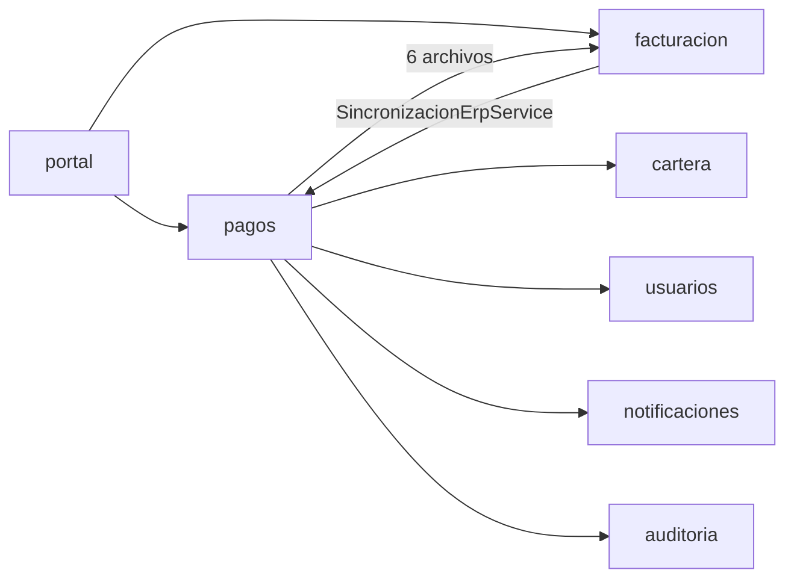
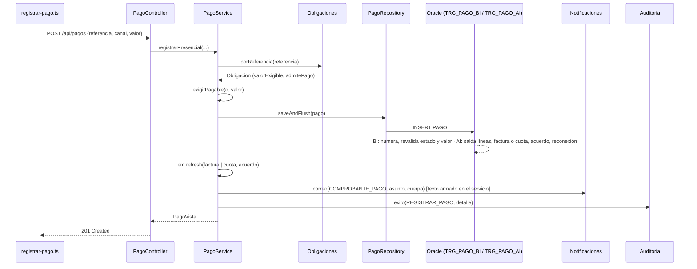
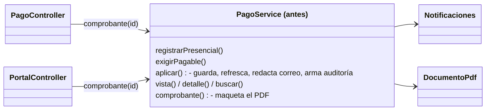
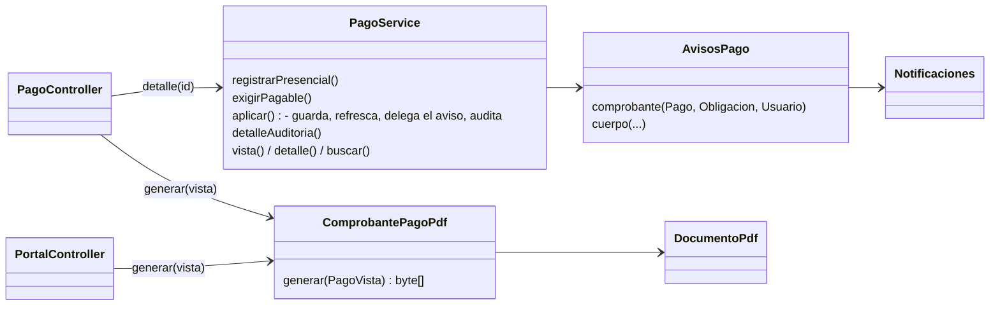

# Diagnóstico técnico y refactorización · Registro de pagos (SIGCA-EPQ)

Ingeniería de Software II · Taller de refactorización y cierre de arquitectura

> **Convenciones.** Las rutas son relativas a la raíz del repositorio; `…/sigca/` abrevia
> `backend/src/main/java/co/gov/epq/sigca/`. Los números de línea corresponden a la **línea base** (el commit anterior a
> `docs: registrar diagnostico tecnico`), salvo donde se indica «después». El script
> `docs/refactorizacion/evidencias/verificar-hallazgos.sh` imprime cada línea citada y cada búsqueda; su salida está en
> `evidencias/verificacion-hallazgos.txt`.

---

## 1. Contexto

| Campo | Valor |
|---|---|
| Equipo | Carlos Esleider Morales · July Tatiana Cartagena Mazo · Samuel Salgado Figueroa |
| Repositorio | https://github.com/CarlosM122/sigca-epq |
| Proyecto | SIGCA-EPQ: gestión comercial y atención al cliente de Empresas Públicas del Quindío |
| Tecnología | Spring Boot 4.1 · Java 21 · Hibernate 7 · Spring Security · Oracle 23 (reglas en triggers y `PKG_SIGCA`) · Angular 21 |
| Arquitectura | Monolito modular con paquetes por dominio (`pagos/`, `facturacion/`, `cartera/`…) y capas controlador → servicio → repositorio JPA; las reglas de integridad se repiten en Oracle («Validaciones en las tres capas», `README.md` l. 14) |
| Funcionalidad | **Registro de un pago** de una factura o de una cuota de acuerdo (caja, recaudo bancario y pago en línea aprobado por la pasarela) y emisión del comprobante por correo y en PDF |
| Requisitos relacionados | RF-06 (registro de pagos) · CU-04 (pago de la factura; en el portal, en línea) · P-05 y CO-02 (sin abonos: se paga el valor exigible exacto) · P-18 (referencia de pago) · P-23 (recaudo bancario con referencia del banco) · RN-05 y RN-15 (el pago en línea solo lo confirma la pasarela, con firma e idempotencia) · RN-33 (lo que está en reclamo no es exigible) · RN-36 (reconexión al pagar) · SWR-07 (el pago salda la factura o la cuota en la misma transacción) · SWR-08 (comprobante electrónico) |

Los requisitos salen de los Javadoc de `PagoService`, `PagoController`, `Obligaciones` y `PortalController`, y de los
comentarios del esquema (`database/sql/01_tablas.sql` l. 860; `03_logica.sql` l. 1609 y 1751). Los escenarios de
aceptación están en `docs/guia-pruebas.md` (E6, E7 y E9.7).

**Alcance.** Incluye `PagoService.registrarPresencial` y `PagoService.aplicar` (por donde pasan caja, banco y el
webhook de la pasarela), la resolución de la obligación en `Obligaciones`, el comprobante (correo y PDF) y los triggers
`TRG_PAGO_*`. Quedan fuera la creación del intento de pago en línea (`PagoEnLineaService.iniciar`), que solo se cita para
comparar reglas (H-04), la búsqueda de pagos y la sincronización con el ERP, citada solo como evidencia de dependencias
(H-03).

**Por qué esta funcionalidad.** Es una transacción de negocio que, con un solo `INSERT` en `PAGO`, cambia el estado de
varias entidades: `TRG_PAGO_AI` salda las `LINEA_FACTURA` (y con ellas la `FACTURA`) o la `CUOTA_ACUERDO` y su
`ACUERDO_PAGO`, cierra el `COBRO_PERSUASIVO` y ordena la reconexión (`PKG_SIGCA.reconectar_si_procede`); el servicio
deja además `NOTIFICACION` y `LOG_AUDITORIA`. La usan tres canales (caja, banco y pasarela) y dos clientes (funcionario
y portal ciudadano).

## 2. Arquitectura real

### 2.1 Componentes

| Capa | Componente | Responsabilidad observada |
|---|---|---|
| Frontend | `frontend/src/app/features/pagos/registrar-pago.ts`, `pagos.service.ts` | Busca la obligación, envía el pago y descarga el comprobante |
| Controlador | `…/sigca/pagos/PagoController.java` | `GET /api/pagos/obligacion`, `POST /api/pagos`, consulta y `GET /api/pagos/{id}/comprobante`; valida el DTO `PagoRequest` con Bean Validation y delega: no toma decisiones de dominio |
| Controlador | `…/sigca/portal/PortalController.java` | `GET /api/portal/pagos/{id}/comprobante`: comprueba que el pago sea del ciudadano (`PortalService.codigoPagoPropio`) y devuelve el PDF |
| Controlador | `…/sigca/pagos/PasarelaPublicaController.java` → `ReceptorWebhook` (`@Component`) | `POST /api/publico/pasarela/webhook`: verifica la firma HMAC y entrega la notificación a `PagoEnLineaService.procesar` |
| Servicio | `…/sigca/pagos/PagoService.java` | Registro presencial y bancario, aplicación del pago (también para el pago en línea), vista, búsqueda y PDF del comprobante |
| Servicio | `…/sigca/pagos/PagoEnLineaService.java` | Intento ante la pasarela y webhook; al aprobarse delega en `PagoService.aplicar` (l. 142) |
| Dominio | `…/sigca/pagos/Obligaciones.java` (`@Component`) y el record `Obligacion` | Resuelve la referencia (FAC-… o AP-…-NN), calcula el valor exigible y decide si la obligación admite pago |
| Entidades | `pagos/Pago`, `facturacion/Factura`, `cartera/CuotaAcuerdo`, `cartera/AcuerdoPago`, `usuarios/Usuario` | Mapeos JPA con Lombok, sin métodos propios: las reglas viven en `Obligaciones`, en los servicios y en los triggers |
| Persistencia | `PagoRepository`, `PagosCuotasRepository`, `PagosAcuerdosRepository`, `facturacion/FacturaRepository`, `facturacion/LineaFacturaRepository`, `facturacion/FacturacionUsuariosRepository` | Spring Data JPA |
| Transversales | `auditoria/Auditoria`, `notificaciones/Notificaciones`, `facturacion/DocumentoPdf` | Registro de auditoría; cola de correo (`correo` encola y `despachar` envía cada 30 s); utilidades de OpenPDF y de formato |
| Base de datos | `database/sql/03_logica.sql`: `TRG_PAGO_BI` (l. 1685), `TRG_PAGO_AI` (l. 1752), `TRG_PAGO_BUD` (l. 1800) | `BI` numera el pago y revalida estado y valor; `AI` salda líneas o cuota y acuerdo, reconecta y cierra el cobro persuasivo; `BUD` impide borrar o alterar el pago |

### 2.2 Dependencias

`PagoService` (l. 42-50) depende de `PagoRepository`, `Obligaciones`, `FacturaRepository`, `PagosCuotasRepository`,
`PagosAcuerdosRepository`, `FacturacionUsuariosRepository`, `Auditoria`, `Notificaciones` y `EntityManager`, y de forma
estática de `DocumentoPdf` (formato y PDF) y `UsuarioActual` (seguridad).

Dependencias de `pagos` y del portal que lo usa, según los `import` de la línea base:



La flecha `facturacion → pagos` cierra un ciclo con `pagos → facturacion` (H-03).

### 2.3 Flujo del pago presencial



El pago en línea entra por `PasarelaPublicaController` → `ReceptorWebhook` (verifica la firma) →
`PagoEnLineaService.procesar` y, desde la aprobación, sigue el mismo camino (`PagoService.aplicar`,
`PagoEnLineaService.java` l. 142). El comprobante sale de `PagoController.comprobante` o `PortalController.comprobante`
→ `PagoService.comprobante` → `DocumentoPdf`.

### 2.4 Pruebas que protegen la funcionalidad (línea base)

| Prueba | Tipo | Qué cubre | Requisito para correrla |
|---|---|---|---|
| `backend/src/test/java/co/gov/epq/sigca/pagos/PagoPresencialIT.java` | Integración (MockMvc + Oracle) | Valor exigible, rechazo de abonos (422), estado PAGADA, 1 registro de auditoría, 1 notificación `COMPROBANTE_PAGO`, PDF, doble pago (409) y recaudo bancario | Oracle local con esquema y semilla (`mvn verify`) |
| `backend/src/test/java/co/gov/epq/sigca/pagos/PagoEnLineaIT.java` | Integración | Webhook firmado e idempotente, firma inválida (401), rechazo y reintento, obligaciones ajenas | Igual |
| `database/sql/05_pruebas.sql` | Pruebas PL/SQL de los triggers | Rechazo de abonos (`-20005`, l. 542-543) y de pagos no admitidos (`-20004`, l. 550-551) directamente en Oracle | SQL Developer como `SIGCA` |
| `frontend/src/app/features/pagos/pagos.service.spec.ts` | Unitaria (vitest) | Patrón de referencia y URL de checkout | Node |

No había ninguna prueba unitaria de `PagoService`, y ninguna prueba automática paga una cuota de acuerdo: ese camino
solo lo cubría la guía manual (E9.7).

## 3. Hallazgos

**Método.** Inspección asistida con IA (prompt de la sección 4 de la guía) y verificación manual de cada ubicación,
fragmento y consecuencia contra la línea base, siguiendo la lista de inspección de la guía (3.2). Cada ficha separa los
hechos, comprobables en el código, de las hipótesis. Al asistente de IA se le entregaron el enunciado y el código del
repositorio, que solo contiene credenciales de desarrollo (`application-dev.yml`, marcado «NUNCA usar estos secretos
fuera de un equipo de desarrollo») y datos de prueba ficticios; los secretos de producción llegan por variables de
entorno (`application.yml`) y no están en el repositorio.

### 3.1 Resumen

| ID | Hallazgo | Tipo | Ubicación principal | Criterio | Estado |
|---|---|---|---|---|---|
| [H-01](#h-01) | `PagoService` mezcla la transacción del pago con el texto del correo y el PDF del comprobante | Riesgo arquitectónico | `PagoService.aplicar` l. 121-130; `PagoService.comprobante` l. 198-213 | SRP, cohesión, separación de capas | <!--E:H-01-->Implementado<!--/E--> |
| [H-02](#h-02) | `COMPROBANTE_ENVIADO` se marca cuando el correo solo se encola | Defecto funcional | `PagoService.aplicar` l. 102 y 116 | Exactitud de la información (SWR-08) | Pendiente |
| [H-03](#h-03) | `pagos` y `facturacion` dependen entre sí, y un controlador depende de otros | Riesgo arquitectónico | `PagoService` l. 21 y 25; `SincronizacionErpService` l. 18-19; `PortalController` l. 100 y 120 | Bajo acoplamiento, dependencias acíclicas (ADP) | Pendiente |
| [H-04](#h-04) | La regla «la obligación admite pago» está duplicada fuera de `Obligacion` | Deuda técnica | `PagoService.exigirPagable` l. 84-92; `PagoEnLineaService.iniciar` l. 65-67 | DRY, ubicación de las invariantes | <!--E:H-04-->Implementado<!--/E--> |
| [H-05](#h-05) | Las reglas de admisión están en Java y en `TRG_PAGO_BI` | Oportunidad de mejora | `Obligaciones` l. 80-126; `03_logica.sql` l. 1700-1736 | Consistencia entre capas | Pendiente |
| [H-06](#h-06) | El patrón de la referencia está repetido y una constante no se usa | Deuda técnica | `Obligaciones` l. 32-34; `PagoController` l. 99 | DRY, código muerto | <!--E:H-06-->Implementado<!--/E--> |

### 3.2 Cobertura de la lista de inspección

| Zona | Pregunta de la guía | Resultado |
|---|---|---|
| Controladores | ¿Contienen decisiones del dominio, cálculos o acceso directo a persistencia? | No: `PagoController` y `PortalController` delegan en servicios u `Obligaciones`. Sí dependen de métodos estáticos de otros controladores (H-03). |
| Servicios | ¿Hay responsabilidades independientes mezcladas? ¿Dependencias innecesarias? | Sí: transacción y presentación en `PagoService` (H-01) y repositorio de usuarios de otro módulo (H-03). |
| Dominio | ¿Dónde se aplican las invariantes y reglas de negocio? | En `Obligaciones`, y otra vez en dos servicios (H-04) y en `TRG_PAGO_BI` (H-05). |
| Código | ¿Hay duplicación, nombres ambiguos, condiciones complejas o código muerto? | Duplicación (H-04, H-06), código muerto (H-06) y un nombre que no dice lo que guarda (`COMPROBANTE_ENVIADO`, H-02). Complejidad sin hallazgo: los métodos del flujo presencial tienen complejidad ciclomática aproximada de 7 o menos; el más ramificado es `PagoEnLineaService.procesar` (≈ 12), por cláusulas de guarda e idempotencia que se leen de forma lineal (`evidencias/complejidad.py`). |
| Arquitectura | ¿El código respeta capas, dependencias y decisiones documentadas? | Ciclo `pagos` ↔ `facturacion` y utilidad transversal fuera de `common/` (H-03); reglas repetidas en Java y Oracle por decisión documentada (H-05). |
| Pruebas | ¿Qué verificaciones protegen el comportamiento? | Solo pruebas de integración con Oracle; ninguna unitaria de `PagoService` (2.4). Las dos intervenciones agregan pruebas de caracterización. |

### 3.3 Fichas

<a id="h-01"></a>

#### H-01 · `PagoService` mezcla la transacción del pago con el texto del correo y el PDF del comprobante

| Campo | Contenido |
|---|---|
| Tipo | **Riesgo arquitectónico** (SRP, cohesión, separación de capas) |
| Ubicación | `…/sigca/pagos/PagoService.java`: `aplicar` l. 98-145 (correo l. 121-130, detalle de auditoría l. 132-143) y `comprobante` l. 198-213 |
| Evidencia | `notificaciones.correo(EventoNotificacion.COMPROBANTE_PAGO, u.getCorreo(), u.getId(), "Comprobante de pago " + p.getCodigoPago(), "Hola " + u.getNombreCompleto() + ",\n\nRecibimos su pago.\n" + …` (l. 121-123) y `return DocumentoPdf.generar("Comprobante de pago " + v.codigoPago(), doc -> doc.add(DocumentoPdf.datos("Comprobante", …` (l. 202-203) |
| Observación | Hecho: la clase que guarda el pago y relee la obligación también redacta el correo y maqueta el PDF. Son motivos de cambio distintos: una nueva redacción del correo o un cambio de formato del comprobante obliga a abrir y volver a probar la clase que sostiene la transacción del dinero. No es una sospecha por longitud (`aplicar` ocupa 48 líneas): el problema es que contiene texto de presentación. |
| Criterio | SRP (un motivo de cambio por clase), cohesión y separación de capas. Es riesgo arquitectónico, y no solo deuda local, porque mete presentación en la capa de servicio en el punto común de los tres canales y se aparta del patrón que el proyecto ya usa: `facturacion/FacturaPdf.java` (l. 20, PDF de la factura como `@Component`), `pqr/AvisosPqr.java` (l. 15, «Textos y destinatarios de las notificaciones de PQR») y `cartera/AvisosCartera.java` (l. 15). |
| Impacto y riesgo | Medio. `aplicar` es el punto común de caja, banco y pasarela (`PagoEnLineaService` l. 142), así que un error al tocar un texto afecta los tres canales. El PDF se pide desde dos controladores (`PagoController` l. 86 y `PortalController` l. 120). Sin pruebas unitarias del servicio, cualquier cambio de texto exige Oracle para probarse. |
| Acción propuesta | Extraer `AvisosPago` (texto y envío del correo del comprobante) y `ComprobantePagoPdf` (maquetación del PDF), siguiendo `AvisosPqr` y `FacturaPdf`, y llevar el armado del detalle de auditoría a un método con nombre. Los controladores usan `ComprobantePagoPdf`, como ya usan `FacturaPdf`. |
| Verificación | Pruebas de caracterización escritas **antes** del cambio (correo exacto, detalle de auditoría, orden de operaciones y contenido del PDF) que deben pasar sin modificar sus aserciones; `PagoPresencialIT` y `PagoEnLineaIT`. |
| Estado | <!--E:H-01-->Implementado<!--/E--> (secciones 5 y 6) |

<a id="h-02"></a>

#### H-02 · `COMPROBANTE_ENVIADO` se marca cuando el correo solo se encola

| Campo | Contenido |
|---|---|
| Tipo | **Defecto funcional** (menor: información incorrecta al usuario; no afecta dinero) |
| Ubicación | `PagoService.java` `aplicar` l. 102 y 116; `…/sigca/notificaciones/Notificaciones.java` `correo` l. 37-50 y `despachar` l. 94-122; `database/sql/03_logica.sql` `TRG_PAGO_BUD` l. 1807; `frontend/src/app/features/pagos/registrar-pago.ts` l. 79 |
| Evidencia | `boolean conCorreo = u.getCorreo() != null && !u.getCorreo().isBlank();` … `p.setComprobanteEnviado(conCorreo);` y, en la pantalla del cajero, `@if (c.comprobanteEnviado) { El comprobante se envió al correo del titular. }` |
| Observación | Hechos: el indicador se calcula con «el titular tiene correo», no con «el correo salió». `Notificaciones.correo` solo inserta en `NOTIFICACION`; `despachar` envía cada 30 s y, tras `NOTIFICACION_MAX_INTENTOS` fallos, deja la notificación en `FALLIDA`. El esquema deja abierta la actualización posterior (`TRG_PAGO_BUD` solo permite cambiar «el envío del comprobante y la sincronización con el ERP»), pero ni Java ni Oracle la hacen: hay un solo `setComprobanteEnviado` y en SQL la columna solo aparece en su definición (`01_tablas.sql` l. 923 y 955). Hipótesis: que SWR-08 pida informar el envío real; el texto del requisito no está en el repositorio. |
| Criterio | Exactitud de la información mostrada; un nombre que no corresponde a lo que guarda (SWR-08) |
| Impacto y riesgo | Bajo-medio: el cajero le dice al ciudadano que el comprobante le llegó cuando puede no haber salido nunca. Corregirlo toca `notificaciones`, `pagos`, el frontend y probablemente el texto de la pantalla. |
| Acción propuesta | **Corrección de defecto**, no refactorización: cambiar el mensaje a «se enviará» o actualizar `COMPROBANTE_ENVIADO` cuando `despachar` marque `ENVIADA` la notificación con `ENTIDAD = 'PAGO'`. Antes hay que decidir con el cliente qué significa el campo. |
| Verificación | Prueba de integración con un `EnviadorCorreo` que falla: la vista del pago no debe afirmar el envío; con envío exitoso, sí. |
| Estado | Pendiente (requiere aclarar el requisito) |

<a id="h-03"></a>

#### H-03 · `pagos` y `facturacion` dependen entre sí, y un controlador depende de otros

| Campo | Contenido |
|---|---|
| Tipo | **Riesgo arquitectónico** (acoplamiento entre módulos; dependencia cíclica) |
| Ubicación | `PagoService.java` l. 21 y 25; `Obligaciones.java` l. 18-21; `PasarelaSimuladaController.java` l. 26; `…/sigca/facturacion/SincronizacionErpService.java` l. 18-19; `…/sigca/portal/PortalController.java` l. 100 y 120; `PagoController.java` `pdf` l. 89-95 |
| Evidencia | En `pagos`: `import co.gov.epq.sigca.facturacion.FacturacionUsuariosRepository;` e `import co.gov.epq.sigca.facturacion.DocumentoPdf;`. En `facturacion`: `import co.gov.epq.sigca.pagos.PagoRepository;`. En `PortalController`: `return PagoController.pdf(codigo, pagos.comprobante(id));` y `return FacturaController.pdfDe(servicio.factura(titular(), id), pdf);` |
| Observación | Hechos: seis archivos de `pagos` importan clases de `facturacion`, y `facturacion/SincronizacionErpService` importa `pagos.Pago` y `pagos.PagoRepository`, de modo que los dos paquetes forman un ciclo. `pagos` lee usuarios con el repositorio **de facturación** (`FacturacionUsuariosRepository`), aunque existe `usuarios/UsuarioRepository` y el proyecto da a cada módulo sus propios repositorios (`PagosCuotasRepository`, `PagosAcuerdosRepository`, `FacturacionContratosRepository`…). `DocumentoPdf` lo usan facturación y pagos, también para dar formato a texto que no es PDF (el correo, el checkout simulado), pero vive en `facturacion/`, mientras el `README.md` (l. 94) ubica en `common/` las piezas transversales (errores, cifrado, validaciones, periodos). `PortalController` arma respuestas HTTP con métodos estáticos de otros dos controladores. |
| Criterio | Bajo acoplamiento entre módulos y principio de dependencias acíclicas (ADP): con el ciclo, ninguno de los dos paquetes se puede entender, probar o cambiar sin el otro. No es una violación de DIP: `FacturacionUsuariosRepository` ya es una interfaz; el problema es el módulo al que pertenece. |
| Impacto y riesgo | Medio, sin error inmediato. Hipótesis razonable: un cambio en `FacturacionUsuariosRepository` o en `DocumentoPdf` pensado para facturación puede romper pagos, y el ciclo impide extraer cualquiera de los dos módulos. |
| Acción propuesta | Mover `DocumentoPdf` y el armado de la respuesta PDF a `common/pdf`; usar `usuarios/UsuarioRepository` (o un `PagosUsuariosRepository`); y romper el ciclo llevando la sincronización de pagos con el ERP a `pagos` (o a un paquete de integración), para que `facturacion` no dependa de `pagos`. |
| Verificación | Compilación; `PagoPresencialIT`, `FacturaIT` y las pruebas del portal; una regla ArchUnit `slices().matching("co.gov.epq.sigca.(*)..").should().beFreeOfCycles()`, que hoy falla y después debe pasar. |
| Estado | Pendiente (toca tres módulos; se registra como deuda) |

<a id="h-04"></a>

#### H-04 · La regla «la obligación admite pago» está duplicada fuera de `Obligacion`

| Campo | Contenido |
|---|---|
| Tipo | **Deuda técnica** (duplicación) |
| Ubicación | `PagoService.java` `exigirPagable` l. 84-92; `PagoEnLineaService.java` `iniciar` l. 65-67 |
| Evidencia | En los dos sitios: `if (!o.admitePago()) { throw new ConflictoException("NO_ADMITE_PAGOS", o.motivoNoAdmite()); }` |
| Observación | Hecho: una invariante de `Obligacion` se hace cumplir fuera de ella, en dos servicios, y una de las copias es `public static` dentro de un `@Service`. Hoy las dos copias son idénticas; si cambia el código de error o la condición, hay que acordarse de ambas. |
| Criterio | DRY; ubicación de las invariantes en el dominio («¿Dónde se aplican las invariantes?», lista de inspección) |
| Impacto y riesgo | Bajo: tres líneas en dos sitios, hoy coherentes. |
| Acción propuesta | Hecha en la segunda refactorización (5.2): la regla vive en `Obligacion.exigirAdmitePago()` y la usan `PagoService` y `PagoEnLineaService`; `exigirPagable` deja de ser `public` y solo añade la comprobación del valor exacto (P-05), que no estaba duplicada. |
| Verificación | `AdmisionPagoCaracterizacionTest`, escrita antes del cambio: código, estado HTTP, mensaje y orden de los rechazos en caja y en línea. Además, `PagoPresencialIT` (409 en doble pago, 422 en abono) y `PagoEnLineaIT`. |
| Estado | <!--E:H-04-->Implementado<!--/E--> (secciones 5.2 y 6) |

<a id="h-05"></a>

#### H-05 · Las reglas de admisión del pago están en Java y en el trigger `TRG_PAGO_BI`

| Campo | Contenido |
|---|---|
| Tipo | **Oportunidad de mejora** (decisión de arquitectura documentada; no se modifica el código) |
| Ubicación | `Obligaciones.java` `siguientePendiente` l. 80-84, `deFactura` l. 86-105 y `deCuota` l. 107-126; `database/sql/03_logica.sql` `TRG_PAGO_BI` l. 1700-1736 |
| Evidencia | Java: `BigDecimal exigible = f.getSaldoPendiente().subtract(f.getValorEnReclamo());` y `switch (f.getEstado()) { case PAGADA -> … case EN_ACUERDO -> …`. Oracle: `v_total := v_factura.SALDO_PENDIENTE - v_factura.VALOR_EN_RECLAMO;` y `IF v_factura.ESTADO = 'EN_ACUERDO' THEN …` |
| Observación | Hechos: la duplicación es intencional y está declarada en el `README.md` (l. 14, «Validaciones en las tres capas»): Java da mensajes útiles al cajero y la base garantiza la integridad aunque el pago llegue por otro camino. Hoy las dos versiones aceptan lo mismo, pero en un caso solo gracias a una tercera regla: el orden de cuotas en Java (`siguientePendiente`) solo mira cuotas `PENDIENTE`, mientras que Oracle (l. 1721-1725) cuenta cualquier cuota anterior sin pagar. No divergen porque una cuota `VENCIDA` deja el acuerdo `INCUMPLIDO` (`TRG_CUOTA_AU`, l. 1442-1451) y Java rechaza antes por el estado del acuerdo. |
| Criterio | Consistencia entre capas; trazabilidad de las decisiones de arquitectura |
| Impacto y riesgo | Bajo mientras haya pruebas que ejerzan ambos lados. Riesgo: que las versiones diverjan sin que nadie lo note si cambia alguna de las reglas de las que depende la equivalencia. |
| Acción propuesta | Ninguna en el código. Registrar la decisión como ADR y añadir pruebas de integración para cuota fuera de orden y factura `EN_ACUERDO`. |
| Verificación | Cada caso nuevo se prueba dos veces: por la API, donde Java rechaza con 409 `NO_ADMITE_PAGOS`, y con un `INSERT` directo, donde Oracle rechaza con `-20004`, como ya hace `05_pruebas.sql` (l. 550-551) con el pago no admitido. |
| Estado | Pendiente (sin cambio de código: ADR y pruebas) |

<a id="h-06"></a>

#### H-06 · El patrón de la referencia de pago está repetido y una constante no se usa

| Campo | Contenido |
|---|---|
| Tipo | **Deuda técnica** (duplicación y código muerto) |
| Ubicación | `Obligaciones.java` l. 32-34; `PagoController.java` `PagoRequest` l. 99 |
| Evidencia | `public static final String PATRON_REFERENCIA = "^(FAC-\\d{6}-\\d{7}\|AP-\\d{4}-\\d{6}(-\\d{2})?)$";` (l. 32) y, en el DTO, `@Pattern(regexp = "^(?i)(FAC-\\d{6}-\\d{7}\|AP-\\d{4}-\\d{6}(-\\d{2})?)$", …)` (l. 99) |
| Observación | Hechos: `PATRON_REFERENCIA` es `public static final` y no se usa en ningún archivo del backend (búsqueda en `backend/src`); el mismo patrón se repite como literal en `PagoRequest`, y `Obligaciones` lo vuelve a expresar en los patrones `FACTURA` y `ACUERDO` (l. 33-34). La copia del frontend (`pagos.service.ts` l. 87) no se cuenta: el README declara que el frontend replica las validaciones del backend («espejo del backend»). |
| Criterio | DRY; código muerto («¿Hay duplicación… o código muerto?», lista de inspección) |
| Impacto y riesgo | Bajo: hoy las copias coinciden. Si cambia el formato de la referencia, hay que tocar tres sitios del backend, y la constante sin uso puede hacer creer que el patrón ya está centralizado. |
| Acción propuesta | Hecha en la segunda refactorización (5.2): el DTO usa la constante, `@Pattern(regexp = Obligaciones.PATRON_REFERENCIA, flags = Pattern.Flag.CASE_INSENSITIVE, …)`. Los patrones `FACTURA` y `ACUERDO` se quedan porque separan las partes de la referencia, no la validan. |
| Verificación | Pruebas parametrizadas de Bean Validation en `AdmisionPagoCaracterizacionTest`: 5 referencias válidas (también en minúsculas) y 6 inválidas, con el mismo mensaje antes y después; `PagoPresencialIT`. |
| Estado | <!--E:H-06-->Implementado<!--/E--> (secciones 5.2 y 6) |

## 4. Priorización

Escala de 1 (bajo) a 3 (alto). **Impacto**: beneficio de resolverlo. **Riesgo**: probabilidad de romper el
comportamiento al intervenir. **Esfuerzo**: trabajo y archivos que toca. **Puntaje** = 2 × impacto − riesgo − esfuerzo
+ 3: el impacto pesa doble porque es el beneficio, riesgo y esfuerzo restan porque son costos, y el +3 solo traslada la
escala (de −1 a 7) sin cambiar el orden.

| ID | Impacto | Riesgo de intervenir | Esfuerzo | Puntaje | Decisión |
|---|---|---|---|---|---|
| H-01 | 3 | 1 | 2 | 6 | **Primera refactorización** |
| H-04 | 2 | 1 | 1 | 5 | **Segunda refactorización** |
| H-06 | 1 | 1 | 1 | 3 | **Segunda refactorización**, junto con H-04 |
| H-02 | 2 | 2 | 2 | 3 | Corrección de defecto; requiere aclarar el requisito |
| H-03 | 2 | 2 | 3 | 2 | Deuda registrada; toca tres módulos |
| H-05 | 1 | 3 | 2 | 0 | No se interviene (decisión documentada) |

**Razón de la selección de H-01.** Tiene el mayor puntaje y ataca un problema de responsabilidades (SRP), no de
estilo. Está en el punto por el que pasan los tres canales de pago y se puede hacer sin cambiar el comportamiento
observable: el texto del correo, el detalle de auditoría, el orden de las operaciones dentro de la transacción y el
contenido del PDF se fijan con pruebas de caracterización **antes** de mover código. No toca el esquema Oracle ni los
contratos HTTP. H-04 tiene mejor relación esfuerzo/beneficio, pero menos impacto; H-02 no es una refactorización y
alteraría el comportamiento.

**Razón de la selección de H-04 y H-06.** Son los siguientes en puntaje y los únicos con riesgo y esfuerzo mínimos.
Tocan la misma regla de admisión del pago, no requieren Oracle ni cambian el frontend, y sus rechazos se pueden
fijar con pruebas unitarias antes de mover código. H-02 sigue fuera porque es un defecto, y H-03 queda como deuda
porque toca tres módulos.

## 5. Intervención

Se hicieron dos refactorizaciones, cada una precedida por un commit con sus pruebas de caracterización. Ninguna
corrige defectos: H-02 queda sin tocar a propósito.

### 5.1 Primera refactorización · H-01

**Cambio:** sacar de `PagoService` el texto del correo y la maquetación del PDF del comprobante.





| Aspecto | Antes | Después |
|---|---|---|
| Responsabilidades de `PagoService` | Transacción + texto del correo + PDF | Transacción (guardar, refrescar, auditar) y consultas |
| Líneas de `PagoService.java` / de `aplicar` | 219 / 48 | 195 / 26 |
| Dependencia de `PagoService` con `notificaciones` | Directa (`Notificaciones`, `EventoNotificacion`) | A través de `AvisosPago` (mismo paquete) |
| Dónde se cambia el texto del correo | `PagoService.aplicar` | `AvisosPago.cuerpo` |
| Dónde se cambia el comprobante PDF | `PagoService.comprobante` | `ComprobantePagoPdf.generar` |
| Patrón | Distinto de facturación, PQR y cartera | El de `FacturaPdf`, `AvisosPqr` y `AvisosCartera` |
| Lecturas del pago para descargar el comprobante (`/api/pagos/{id}/comprobante`) | 2 (`obtener` + `comprobante`) | 1 (`detalle`) |

Decisiones:

- `AvisosPago` toma el canal y el código de transacción del `Pago` guardado en lugar de recibir los parámetros sueltos
  de `aplicar`: son los mismos valores (`aplicar` los asigna con `setCanalPago` y `setCodigoTransaccion` antes de
  guardar), y así el método no necesita siete argumentos.
- La auditoría se queda en `PagoService` porque es parte de la transacción del pago, no de la presentación; solo se
  extrajo el armado del mapa a `detalleAuditoria`, que conserva el orden de las claves.
- `ComprobantePagoPdf` recibe la `PagoVista` ya resuelta, como `FacturaPdf` recibe `FacturaDetalle`, y lo invocan los
  controladores, como hacen `FacturaController` y `PortalController` con la factura. El portal sigue comprobando la
  propiedad del pago (`codigoPagoPropio`) antes de generar el PDF.
- No se movieron `DocumentoPdf` ni `PagoController.pdf` (H-03), para mantener el cambio acotado.

Archivos afectados:

| Archivo | Cambio |
|---|---|
| `…/sigca/pagos/AvisosPago.java` | **Nuevo**: correo del comprobante |
| `…/sigca/pagos/ComprobantePagoPdf.java` | **Nuevo**: PDF del comprobante |
| `…/sigca/pagos/PagoService.java` | `Notificaciones` → `AvisosPago`; `aplicar` delega; nuevo `detalleAuditoria`; se elimina `comprobante(id)` |
| `…/sigca/pagos/PagoController.java` | Inyecta `ComprobantePagoPdf`; `comprobante` usa `detalle` + `generar` |
| `…/sigca/portal/PortalController.java` | Inyecta `ComprobantePagoPdf` para el comprobante del ciudadano |
| `backend/src/test/java/co/gov/epq/sigca/pagos/PagoServiceCaracterizacionTest.java` | Solo los dos métodos de *fixture* (constructor y obtención del PDF) |

No cambian los contratos HTTP, los DTO, el esquema Oracle, los triggers, el frontend ni los permisos.

### 5.2 Segunda refactorización · H-04 y H-06

**Cambio:** llevar la regla «la obligación admite pago» al record `Obligacion` y validar la referencia del DTO con la
constante `Obligaciones.PATRON_REFERENCIA`.

**Antes.** La regla estaba escrita dos veces, en `PagoService.exigirPagable` (método `public static` de un `@Service`)
y en `PagoEnLineaService.iniciar`. El patrón de la referencia se repetía como texto en `PagoRequest`, y la constante
que lo contenía no la usaba nadie.

**Después:**

```java
// Obligacion.java: la única copia de la regla en Java
public void exigirAdmitePago() {
    if (!admitePago) {
        throw new ConflictoException("NO_ADMITE_PAGOS", motivoNoAdmite);
    }
}

// PagoService.exigirPagable (ya no es public) y PagoEnLineaService.iniciar
o.exigirAdmitePago();

// PagoController.PagoRequest
@Pattern(regexp = Obligaciones.PATRON_REFERENCIA, flags = Pattern.Flag.CASE_INSENSITIVE,
        message = "Referencia inválida (FAC-AAAAMM-NNNNNNN o AP-AAAA-NNNNNN[-NN])") String referencia
```

| Aspecto | Antes | Después |
|---|---|---|
| Copias de la regla que lanzan `NO_ADMITE_PAGOS` | 2 (`PagoService`, `PagoEnLineaService`) | 1 (`Obligacion.exigirAdmitePago`) |
| Dónde vive la invariante | En los servicios | En el objeto de dominio que tiene los datos |
| Visibilidad de `PagoService.exigirPagable` | `public static` en un `@Service` | De paquete: solo la usan `PagoService` y su prueba |
| Expresión de la referencia escrita como texto en el backend | 2 | 1 (`Obligaciones.PATRON_REFERENCIA`) |
| Usos de `PATRON_REFERENCIA` fuera de su declaración | 0 | 1 (`PagoRequest`) |

Decisiones:

- La comprobación del valor exacto (P-05) se quedó en `PagoService`: solo existe ahí y su mensaje usa
  `DocumentoPdf.pesos`; llevarla a `Obligacion` habría añadido otra dependencia hacia `facturacion` (H-03).
- `exigirPagable` sigue siendo estático y pasa a ser de paquete: es una función sin estado, y la prueba de
  caracterización la usa como punto de entrada sin tener que cambiar.
- El patrón se usa con la bandera `CASE_INSENSITIVE` en lugar del `(?i)` del texto: Hibernate Validator compila la
  expresión con esa bandera y acepta y rechaza las mismas referencias, como fijan las pruebas parametrizadas.
- Los patrones `FACTURA` y `ACUERDO` de `Obligaciones` no se tocaron: separan las partes de la referencia (factura,
  acuerdo y cuota), no la validan.

Archivos afectados:

| Archivo | Cambio |
|---|---|
| `…/sigca/pagos/Obligacion.java` | Nuevo método `exigirAdmitePago()` |
| `…/sigca/pagos/PagoService.java` | `exigirPagable` delega la admisión en `Obligacion` y deja de ser `public` |
| `…/sigca/pagos/PagoEnLineaService.java` | `iniciar` usa `o.exigirAdmitePago()` |
| `…/sigca/pagos/PagoController.java` | `PagoRequest` valida con `Obligaciones.PATRON_REFERENCIA` |
| `…/sigca/pagos/Obligaciones.java` | Javadoc de `PATRON_REFERENCIA` |
| `backend/src/test/java/co/gov/epq/sigca/pagos/AdmisionPagoCaracterizacionTest.java` | Ninguno: se agregó en el commit de pruebas anterior y no cambia |

No cambian los contratos HTTP, los mensajes, los códigos de error, el esquema Oracle ni el frontend.

### 5.3 Respuestas a las preguntas de la sesión

#### 1. ¿Cuál era el problema identificado y dónde estaba localizado?

**H-01.** `PagoService`, la clase que registra el pago dentro de una transacción, también redactaba el correo del
comprobante (`aplicar`, l. 121-130) y maquetaba su PDF (`comprobante`, l. 198-213), en
`backend/src/main/java/co/gov/epq/sigca/pagos/PagoService.java`.

**H-04 y H-06.** La regla «la obligación admite pago» estaba escrita dos veces: en `PagoService.exigirPagable`
(l. 84-92), un método `public static` de un servicio, y en `PagoEnLineaService.iniciar` (l. 65-67). Además, el patrón
de la referencia de pago estaba declarado en `Obligaciones.PATRON_REFERENCIA` (l. 32) sin que nadie lo usara, y se
repetía como texto en `PagoController.PagoRequest` (l. 99).

#### 2. ¿Qué principio de diseño o atributo de calidad estaba comprometido?

**H-01.** El principio de responsabilidad única (SRP): la clase tenía dos motivos de cambio, el registro del dinero y
la presentación del comprobante. Eso bajaba su cohesión y mezclaba presentación con la capa de servicio. No era un
problema de longitud: `aplicar` tenía 48 líneas.

**H-04 y H-06.** DRY (no repetir conocimiento) y la ubicación de las invariantes: una regla del dominio vivía fuera del
objeto que tiene los datos, y la constante sin uso era código muerto. El atributo afectado es la mantenibilidad:
cambiar la regla o el formato de la referencia obligaba a recordar varios sitios.

#### 3. ¿Qué modificación realizaron y cómo cambiaron las responsabilidades o dependencias?

**H-01.** Se extrajeron dos componentes, siguiendo `AvisosPqr` y `FacturaPdf`: `AvisosPago`, que arma y encola el
correo, y `ComprobantePagoPdf`, que genera el PDF. `PagoService` se quedó con la transacción (guardar, refrescar y
auditar) y dejó de depender de `notificaciones`; ahora depende de `AvisosPago`. `PagoController` y `PortalController`
piden el PDF a `ComprobantePagoPdf` y no al servicio.

**H-04 y H-06.** La regla pasó a `Obligacion.exigirAdmitePago()`: `PagoService` y `PagoEnLineaService` la invocan en
lugar de copiarla, y `exigirPagable` dejó de ser `public`. `PagoRequest` valida con `Obligaciones.PATRON_REFERENCIA` y
la bandera `CASE_INSENSITIVE`. La dependencia va ahora de los servicios hacia el dominio, que es quien hace cumplir su
propia regla.

#### 4. ¿Qué consecuencias tiene el cambio sobre la arquitectura de la aplicación?

**H-01.** La capa de servicio quedó sin código de presentación, y el módulo `pagos` sigue el mismo patrón que
facturación, PQR y cartera. Un cambio en el texto del correo o en el formato del comprobante ya no toca la clase de la
transacción del dinero, por la que pasan caja, banco y pasarela.

**H-04 y H-06.** El dominio de pagos concentra su invariante y los servicios solo orquestan. El rechazo «no admite
pago» se cambia en un único sitio de Java, y Oracle lo sigue validando en `TRG_PAGO_BI`, como define la decisión de
«validaciones en las tres capas» del `README.md`.

**Lo que no cambió.** Ningún contrato HTTP, mensaje, código de error, tabla ni trigger. El ciclo entre `pagos` y
`facturacion` (H-03) sigue igual y queda registrado como deuda técnica.

#### 5. ¿Qué evidencias demuestran que la funcionalidad conserva su comportamiento?

- **Pruebas de caracterización escritas antes de cada cambio:** `PagoServiceCaracterizacionTest` (10 pruebas: datos del
  pago, orden de las operaciones, correo exacto, auditoría y PDF) y `AdmisionPagoCaracterizacionTest` (18 casos:
  código, estado HTTP, mensaje y orden de cada rechazo, y referencias válidas e inválidas).
- **Resultados en tres puntos del historial** (6.3): antes de H-01, después de H-01 y después de H-04 y H-06, con la
  salida de Maven guardada en `evidencias/`.
- **Aserciones intactas:** en H-01 solo cambió el *fixture* de la prueba (5 líneas) y en H-04 y H-06 no cambió ninguna
  línea de las pruebas (6.2).
- **Textos idénticos:** los literales del correo, la auditoría y el PDF son los mismos antes y después: 17/17, 7/7 y
  15/15 (`evidencias/comparacion-literales.txt`).
- **Pruebas de integración:** `PagoPresencialIT` y `PagoEnLineaIT` cubren el flujo completo contra Oracle.

## 6. Verificación

### 6.1 Estrategia

1. **Pruebas antes de cada cambio.** Cada refactorización tiene un commit previo de pruebas de caracterización (JUnit 5,
   Mockito y AssertJ, sin Oracle). Para H-01, `PagoServiceCaracterizacionTest` (10 pruebas):

   | Prueba | Qué fija |
   |---|---|
   | `pagoPresencialDeFacturaGuardaElPagoConLosDatosDeLaObligacion` | Los 11 campos del `Pago` que se inserta |
   | `losEfectosOcurrenEnOrdenGuardarRefrescarNotificarAuditar` | Orden dentro de la transacción |
   | `elCorreoDelComprobanteConservaDestinatarioAsuntoYCuerpo` | Evento, destinatario, asunto y cuerpo exactos |
   | `elPagoEnLineaIncluyeLaTransaccionEnElCorreoYEnLaAuditoria` | Canal `EN_LINEA` y código de transacción en el correo y en la auditoría |
   | `laAuditoriaDelPagoPresencialTieneLasClavesEnOrdenYSinOpcionales` | Operación, entidad y detalle con las claves en orden |
   | `elRecaudoBancarioAuditaLaReferenciaDelBanco` | P-23 en el pago y en la auditoría |
   | `sinCorreoElComprobanteNoQuedaMarcadoComoEnviadoYLaColaRecibeElDestinoEnBlanco` | `COMPROBANTE_ENVIADO = N` y llamada a la cola con destino en blanco |
   | `elPagoDeUnaCuotaRefrescaLaCuotaYElAcuerdo` | Rama de cuota: refresca la cuota y luego el acuerdo; referencia `AP-…-00` |
   | `elComprobantePdfConservaTituloYDatosDelPago` | PDF válido de una página, con título y datos del pago |
   | `laVistaDelPagoNoCambia` | `PagoVista` completa |

   Para H-04 y H-06, `AdmisionPagoCaracterizacionTest` (7 pruebas y 2 parametrizadas, 18 casos en total):

   | Prueba | Qué fija |
   |---|---|
   | `unaObligacionQueNoAdmitePagoSeRechazaConConflictoYSuMotivo` | Código `NO_ADMITE_PAGOS`, estado 409 y el motivo como mensaje |
   | `laAdmisionSeRevisaAntesQueElValor` | Orden de las dos comprobaciones |
   | `unValorDistintoDelExigibleSeRechazaPorqueNoHayAbonos` | Código `VALOR_NO_COINCIDE`, estado 422 y mensaje exacto (P-05) |
   | `sinValorTambienSeRechazaPorValor` | Valor nulo |
   | `elValorExactoSeAceptaAunqueCambieLaEscala` | `123620` y `123620.00` son el mismo valor |
   | `elPagoEnLineaRechazaUnaObligacionQueNoAdmitePagoSinAbrirIntentos` | Mismo rechazo en línea, sin consultar intentos de pago |
   | `elPagoEnLineaDeUnaObligacionAjenaNoRevelaSiExisteAntesDeRevisarLaAdmision` | La propiedad se revisa antes que la admisión |
   | `laReferenciaDelPagoAceptaFacturasYCuotasSinImportarMayusculas` (5 casos) | Referencias válidas, también en minúsculas |
   | `laReferenciaDelPagoRechazaFormatosInvalidosConElMismoMensaje` (6 casos) | Referencias inválidas y el mensaje del DTO |

2. **Regla de conservación:** durante una refactorización solo puede cambiar el *fixture* de las pruebas. En H-01
   cambiaron 5 líneas de `crearServicio()` y `comprobante(Long)`; en H-04 y H-06, ninguna.
3. **Tres puntos de control en copias limpias.** `evidencias/ejecutar-verificacion.sh` corre las pruebas en cada punto,
   cada uno en su propio `git worktree`: **A**, antes de H-01 (commit `test: caracterizar el registro de pagos…`);
   **B**, después de H-01 y antes de H-04 y H-06 (`test: caracterizar la admision del pago…`); y **C**, después de las
   dos (`refactor: centralizar la regla de admision…`). Con `INTEGRACION=1` también corre `PagoPresencialIT` y
   `PagoEnLineaIT` contra Oracle en A y en C.
4. **Complementaria, manual (guía E7 y E6.8):** pago presencial de `FAC-202608-0000002` y pago en línea de
   `FAC-202609-0000004`, descarga del comprobante desde **Registrar pago** y desde **Mis pagos** del portal, y consulta
   de `NOTIFICACION` (`EVENTO = 'COMPROBANTE_PAGO'`) para comparar el cuerpo del correo.

### 6.2 Comprobaciones estáticas

| Refactorización | Comprobación | Antes → después |
|---|---|---|
| H-01 | Literales del correo, del detalle de auditoría y del PDF | Idénticos y en el mismo orden: 17/17, 7/7 y 15/15 |
| H-01 | Llamadas a `PagoService.comprobante` en el código principal | 2 → 0 |
| H-01 | `import` de `notificaciones` en `PagoService` | 2 → 0 |
| H-01 | Cambios en `PagoServiceCaracterizacionTest` | 5 líneas, solo en `crearServicio()` y `comprobante(Long)` |
| H-04 | Sitios del código principal que lanzan `NO_ADMITE_PAGOS` | 2 → 1 |
| H-06 | Expresión de la referencia escrita como texto en el backend | 2 → 1 |
| H-06 | Usos de `PATRON_REFERENCIA` fuera de su declaración | 0 → 1 |
| H-04 y H-06 | Cambios en las pruebas durante la segunda refactorización | 0 líneas |

Evidencia: `evidencias/comprobaciones-estaticas.txt` y `evidencias/comparacion-literales.txt`.

### 6.3 Resultados de las pruebas

| Comprobación | A · antes de H-01 | B · después de H-01 | C · después de H-04 y H-06 |
|---|---|---|---|
| `PagoServiceCaracterizacionTest` (10 pruebas) | <!--R:C1_A-->pendiente de ejecutar<!--/R--> | <!--R:C1_B-->pendiente de ejecutar<!--/R--> | <!--R:C1_C-->pendiente de ejecutar<!--/R--> |
| `AdmisionPagoCaracterizacionTest` (18 casos) | Todavía no existe | <!--R:C2_B-->pendiente de ejecutar<!--/R--> | <!--R:C2_C-->pendiente de ejecutar<!--/R--> |
| Todas las pruebas unitarias (`mvn test`) | <!--R:U_A-->pendiente de ejecutar<!--/R--> | <!--R:U_B-->pendiente de ejecutar<!--/R--> | <!--R:U_C-->pendiente de ejecutar<!--/R--> |
| `PagoPresencialIT` y `PagoEnLineaIT` (Oracle) | <!--R:IT_A-->pendiente de ejecutar<!--/R--> | No se corren en B | <!--R:IT_C-->pendiente de ejecutar<!--/R--> |

Evidencia: `evidencias/pruebas-1-antes.txt`, `pruebas-2-tras-h01.txt` y `pruebas-3-tras-h04-h06.txt` (salida de Maven
de cada punto). Criterio de aceptación: cada prueba de caracterización pasa en todos los puntos donde existe, sin
fallos ni errores y con sus aserciones intactas. Si una prueba falla **antes** de su refactorización, el error está en la
prueba (no describe el comportamiento actual) y se corrige antes de evaluar el cambio.

Para reproducirlo, desde la raíz del repositorio, con JDK 21 y Maven 3.9 (Git Bash en Windows):

```bash
bash docs/refactorizacion/evidencias/ejecutar-verificacion.sh                  # unitarias, sin Oracle
INTEGRACION=1 bash docs/refactorizacion/evidencias/ejecutar-verificacion.sh    # + integración (Oracle con esquema y semilla, ver README)
```

### 6.4 Análisis de la mejora

| Medida | Línea base | Después de H-01 | Después de H-04 y H-06 |
|---|---|---|---|
| Clase que se toca para cambiar el texto del correo | `PagoService` (la de la transacción) | `AvisosPago` | `AvisosPago` |
| Clase que se toca para cambiar el formato del comprobante | `PagoService` | `ComprobantePagoPdf` | `ComprobantePagoPdf` |
| Sitios que se tocan para cambiar el rechazo «no admite pago» | 2 servicios | 2 servicios | 1 (`Obligacion`) |
| Sitios que se tocan para cambiar el formato de la referencia | 3, en 2 clases | 3, en 2 clases | 2, en `Obligaciones` |
| `import` de `notificaciones` en `PagoService` | 2 | 0 | 0 |
| Líneas de `PagoService.java` / de `aplicar` | 219 / 48 | 195 / 26 | 195 / 26 |
| Pruebas unitarias del flujo de pago | 0 | 10 | 28 |

La mejora está en dónde se hace cada cambio, no en el tamaño del código: el texto del correo, el formato del
comprobante y el rechazo por admisión tienen ahora un solo lugar, separado de la transacción del dinero. El costo
es moderado: dos clases nuevas y un método más en `Obligacion`. `PagoService` conserva el mismo número de dependencias
(cambió `Notificaciones` por `AvisosPago`) y el ciclo entre `pagos` y `facturacion` (H-03) sigue igual.

### 6.5 Limitaciones

- El diagnóstico y los cambios se prepararon en un entorno sin Maven Central ni Docker/Oracle, donde solo se hicieron las
  comprobaciones estáticas de 6.2; los resultados de 6.3 salen de `ejecutar-verificacion.sh` en un equipo del grupo.
- Las pruebas unitarias sustituyen los triggers con dobles: no prueban que Oracle salde la factura ni que reconecte; eso
  lo siguen cubriendo las pruebas de integración y `05_pruebas.sql`.
- El pago de una cuota de acuerdo solo lo cubren la prueba de caracterización (`elPagoDeUnaCuotaRefrescaLaCuotaYElAcuerdo`)
  y la guía manual (E9.7): ninguna prueba de integración paga cuotas.
- El PDF se compara por título, número de páginas y presencia de los datos en el contenido, no byte a byte, porque
  OpenPDF incluye una fecha de creación y un identificador distintos en cada generación.
- La prueba del PDF usa `PdfReader` de OpenPDF 3 (`org.openpdf.text.pdf`); si el proyecto cambia de versión mayor, hay
  que ajustar ese `import`.
- La validación de `PagoRequest` se prueba con Hibernate Validator directamente, no a través de la petición
  HTTP; la petición completa la cubre `PagoPresencialIT`.

## 7. Cierre

**Lecciones.**

- La IA sirvió para ubicar rápido los componentes y proponer hallazgos, pero no para darlos por buenos. La revisión de
  la primera versión del diagnóstico corrigió tres afirmaciones: H-03 hablaba de una violación de DIP que no se sostiene
  (`FacturacionUsuariosRepository` ya es una interfaz; lo que sí se demuestra es el ciclo de paquetes); atribuía al
  `README.md` una regla sobre `common/` que el texto no dice; y H-04 mezclaba dos problemas, que ahora son H-04 y H-06.
- El argumento válido para H-01 fue el **motivo de cambio**, no la longitud del método, apoyado en patrones que el
  propio proyecto ya usa (`FacturaPdf`, `AvisosPqr`, `AvisosCartera`).
- La segunda refactorización se diseñó para que el cambio no tocara ni una línea de su prueba: se probó el
  comportamiento observable (código, estado HTTP, mensaje y orden de los rechazos), no la forma del código.
- No todo hallazgo se refactoriza: H-05 es una decisión documentada, y H-02 es un defecto que cambiaría el comportamiento
  y debe declararse y tratarse como corrección.
- Las pruebas de caracterización escritas antes del cambio son lo que permite afirmar que el comportamiento se conserva;
  antes, la única red era una suite de integración que exige Oracle.

**Deuda técnica pendiente**, en orden de prioridad:

1. H-02: aclarar el significado de `COMPROBANTE_ENVIADO` y corregir el mensaje del cajero o actualizar el campo al enviar.
2. H-03: romper el ciclo `pagos` ↔ `facturacion`, mover `DocumentoPdf` y la respuesta PDF a `common/` y dar a `pagos` su
   propio acceso a usuarios.
3. H-05: registrar la decisión «reglas en Java y en Oracle» como ADR y añadir pruebas de integración de cuotas fuera de
   orden y de factura `EN_ACUERDO`.

**Pregunta de cierre: ¿qué práctica del proceso de desarrollo habría permitido detectar estos problemas antes de
entregar la aplicación?** La revisión de código con una lista de verificación de arquitectura en cada *pull request*,
respaldada por reglas automáticas en la integración continua. Cada práctica habría atrapado hallazgos concretos:

| Práctica | Hallazgos | Cómo los habría detectado |
|---|---|---|
| Revisión de código con lista de verificación de arquitectura | H-01, H-03, H-04 | Preguntas como «¿la clase tiene más de un motivo de cambio?», «¿sigue el patrón `XxxPdf` / `AvisosXxx`?», «¿importa paquetes internos de otro módulo?» o «¿esta regla ya existe en el dominio?»; todo se ve en el diff de la primera versión de `PagoService` |
| Reglas de arquitectura automáticas (ArchUnit en `mvn test`) | H-03 | «Sin ciclos entre paquetes», «`pagos` no usa repositorios de `facturacion`» y «ningún controlador depende de otro» fallan en el commit que introduce el problema |
| Pruebas unitarias en la definición de terminado | H-01 | Escribir la prueba del correo obliga a construir `PagoService` con nueve dependencias, una señal temprana de baja cohesión |
| Inspecciones del IDE o análisis estático | H-06 | Señalan la constante sin uso |
| Criterios de aceptación verificables | H-02 | «El comprobante se envió» frente a «se encoló» habría salido al refinar SWR-08 |

## 8. Git

| # | Commit | Contenido | Hash |
|---|---|---|---|
| 0 | Línea base | Código recibido | <!--H:BASE-->por completar<!--/H--> |
| 1 | `docs: registrar diagnostico tecnico` (sesión 1) | Diagnóstico: secciones 1 a 4 | <!--H:DIAG-->por completar<!--/H--> |
| 2 | `test: caracterizar el registro de pagos antes de refactorizar` | `PagoServiceCaracterizacionTest` | <!--H:TEST1-->por completar<!--/H--> |
| 3 | `refactor: separar responsabilidades del registro de pagos` | H-01: `AvisosPago`, `ComprobantePagoPdf`, `PagoService`, los dos controladores y el *fixture* de la prueba | <!--H:REF1-->por completar<!--/H--> |
| 4 | `test: caracterizar la admision del pago antes de la segunda refactorizacion` | `AdmisionPagoCaracterizacionTest` | <!--H:TEST2-->por completar<!--/H--> |
| 5 | `refactor: centralizar la regla de admision del pago en Obligacion` | H-04 y H-06: `Obligacion`, `PagoService`, `PagoEnLineaService`, `PagoController` y `Obligaciones` | <!--H:REF2-->por completar<!--/H--> |
| 6 | `docs: documentar verificacion de refactorizacion` | Secciones 5 a 8, evidencias y scripts | Este commit |

Cada refactorización va precedida de su commit de pruebas, para que la comparación antes/después sea reproducible.
